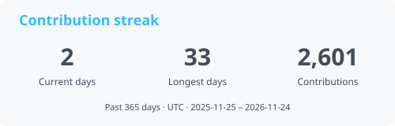
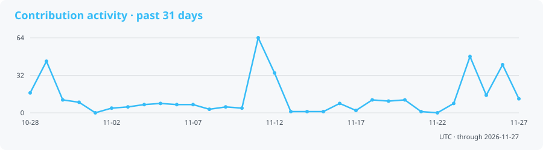

<!-- Generated by scripts/profile.py readme; edit profile.config.json instead. -->

<picture>
  <source media="(prefers-color-scheme: dark)" srcset="https://raw.githubusercontent.com/axclogo/axclogo/output/cards/stats-dark.svg" />
  
</picture>
<picture>
  <source media="(prefers-color-scheme: dark)" srcset="https://raw.githubusercontent.com/axclogo/axclogo/output/cards/languages-dark.svg" />
  
</picture>

<picture>
  <source media="(prefers-color-scheme: dark)" srcset="https://raw.githubusercontent.com/axclogo/axclogo/output/activity/streak-dark.svg" />
  
</picture>

<picture>
  <source media="(prefers-color-scheme: dark)" srcset="https://raw.githubusercontent.com/axclogo/axclogo/output/activity/graph-dark.svg" />
  
</picture>

<a href="https://github.com/axclogo/AxcAgentEngine">
<picture>
  <source media="(prefers-color-scheme: dark)" srcset="https://raw.githubusercontent.com/axclogo/axclogo/output/cards/repo-AxcAgentEngine-dark.svg" />
  
</picture>
</a>

<a href="https://github.com/axclogo/AxcBedrock-Swift">
<picture>
  <source media="(prefers-color-scheme: dark)" srcset="https://raw.githubusercontent.com/axclogo/axclogo/output/cards/repo-AxcBedrock-Swift-dark.svg" />
  
</picture>
</a>
<a href="https://github.com/axclogo/AxcBedrock-Dart">
<picture>
  <source media="(prefers-color-scheme: dark)" srcset="https://raw.githubusercontent.com/axclogo/axclogo/output/cards/repo-AxcBedrock-Dart-dark.svg" />
  
</picture>
</a>

<a href="https://github.com/axclogo/AxcUIKit-Swift">
<picture>
  <source media="(prefers-color-scheme: dark)" srcset="https://raw.githubusercontent.com/axclogo/axclogo/output/cards/repo-AxcUIKit-Swift-dark.svg" />
  
</picture>
</a>
<a href="https://github.com/axclogo/AxcUIKit-Dart">
<picture>
  <source media="(prefers-color-scheme: dark)" srcset="https://raw.githubusercontent.com/axclogo/axclogo/output/cards/repo-AxcUIKit-Dart-dark.svg" />
  
</picture>
</a>

<a href="https://github.com/axclogo/AxcPermission-Swift">
<picture>
  <source media="(prefers-color-scheme: dark)" srcset="https://raw.githubusercontent.com/axclogo/axclogo/output/cards/repo-AxcPermission-Swift-dark.svg" />
  
</picture>
</a>
<a href="https://github.com/axclogo/AxcPermission-Dart">
<picture>
  <source media="(prefers-color-scheme: dark)" srcset="https://raw.githubusercontent.com/axclogo/axclogo/output/cards/repo-AxcPermission-Dart-dark.svg" />
  
</picture>
</a>

<picture>
  <source media="(prefers-color-scheme: dark)" srcset="https://raw.githubusercontent.com/axclogo/axclogo/output/github-contribution-grid-snake-dark.svg" />
  
</picture>

